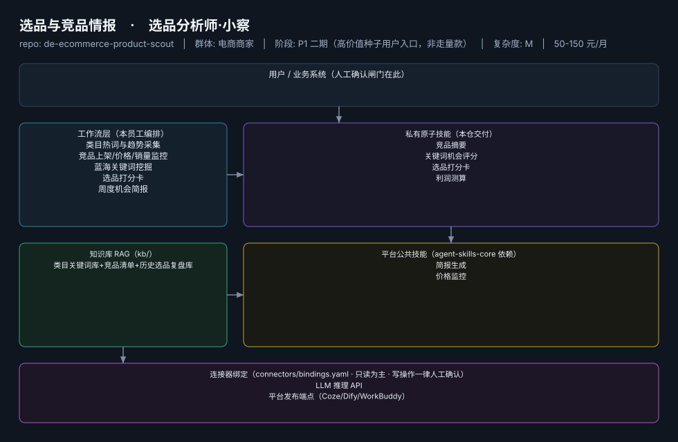
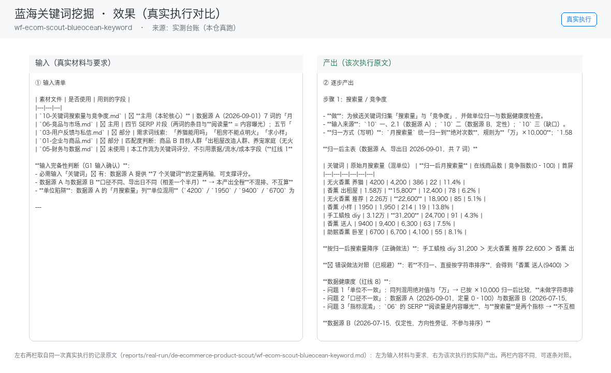

# 选品与竞品情报

> 选品分析师·小察 ｜ 给结论不给仪表盘，把生意参谋/蝉妈妈翻译成决策
>
> **选品分析师·小察**　·　电商商家　·　阶段 P1 二期（高价值种子用户入口，非走量款）　·　
> 复杂度 M　·　50-150 元/月　·　定义卡 6.4-⑥



## 效果（真实执行）



*上图为**真实效果对比**，不是示意图：左栏是输入材料与要求，右栏是该次执行的产出原文，
两栏取自同一次真实执行记录。*

- 完整台账：[`reports/real-run/wf-ecom-scout-blueocean-keyword.md`](reports/real-run/wf-ecom-scout-blueocean-keyword.md)
- 录屏与终端回放：[`workflows/wf-ecom-scout-blueocean-keyword/docs/images/`](workflows/wf-ecom-scout-blueocean-keyword/docs/images/)（`08-demo-run.gif` / `08-demo-run.mp4` / `04-terminal-run.png`）
- 使用示例：[`workflows/wf-ecom-scout-blueocean-keyword/docs/使用示例.md`](workflows/wf-ecom-scout-blueocean-keyword/docs/使用示例.md)
> 实测判定：**通过**　·　可用度 4/5　·　编造数字 0 处　·　红线命中 2 次 / 拦截 2 次


**一句话**：有数据意识的腰部卖家（约占 20-30%，据R3调研）

---

## 这个数字员工解决什么问题

选品分析师·小察 ｜ 给结论不给仪表盘，把生意参谋/蝉妈妈翻译成决策

| 项 | 内容 |
|---|---|
| 服务对象 | 有数据意识的腰部卖家（约占 20-30%，据R3调研） |
| 可量化目标 | 周报采纳率 ≥60%；选中款 30 天动销率 ≥50%；竞品异动推送 ≤2 小时 |
| 投入产出 | 对标蝉妈妈专业版年费 1.2 万（据R5调研）；月省 12h≈¥360 |
| 需求依据 | D12、D06 |
| 分发渠道 | GitHub、Dify Marketplace（数据分析型 Workflow 高需品类） |

## 30 秒上手

```bash
git clone <本仓库地址> && cd de-ecommerce-product-scout
pip install pyyaml
python3 tests/run.py            # 先跑一遍自检，确认环境与契约都对得上
```

试用（把 `<输入>` 换成本人真实材料）：

```text
请以「选品与竞品情报」的身份，帮我跑「类目热词与趋势采集」。
材料如下：<输入>
要求：只使用材料里出现过的数字，缺的写 <待填>；对外文案停在待确认状态。
```

详细接入见 [`docs/01-安装与接入.md`](docs/01-安装与接入.md)。

## 仓库结构

```text
de-ecommerce-product-scout/
├── employee.yaml          # 机器契约（能力清单 + 依赖锁）
├── dependencies.yaml      # 对 core 的外部依赖（含版本）
├── persona/               # 运行提示词 / 边界 / KPI
├── skills/                # 私有原子技能（4 个）
├── spec-bindings/         # 有意不公共化能力的本地绑定声明（1 个）
├── workflows/             # 本员工工作流（5 条）
├── kb/                    # 知识库 RAG 契约
├── connectors/            # 连接器绑定（只读为主，写操作人工确认）
├── docs/                  # 六类发布文档
└── tests/                 # 自动化多场景测试
```

## 私有原子技能（4）

| 技能 | slug | 复杂度 | 阶段 | 成熟度 |
|---|---|---|---|---|
| `竞品摘要` | `competitor-digest` | M | P1 | 契约完备 |
| `关键词机会评分` | `keyword-opportunity-score` | S | P1 | 契约完备 |
| `选品打分卡` | `product-selection-scorecard` | S | P1 | 契约完备 |
| `利润测算` | `profit-calculator` | S | P1 | 契约完备 |

## 平台公共技能依赖（2）

| 技能 | slug | 全平台复用员工数 |
|---|---|---|
| `简报生成` | `brief-generator` | 10 |
| `价格监控` | `price-monitor` | 2 |

> 这些技能来自 `agent-skills-core@1.0.0`，本仓库**只引用不复制**。

## Spec 绑定层（1）

| 能力 | slug | 契约位置 | 本仓落点 |
|---|---|---|---|
| `数据对接` | `data-ingest-adapter` | `agent-skills-core/specs/data-ingest-adapter.md` | `spec-bindings/data-ingest-adapter.md` |

> 这一族能力**有意不公共化**（与外部平台接口强绑定）。本仓不存正文，
> 只留本地绑定声明与连接器配置。

## 工作流（5）

| 工作流 | slug | 触发 | 阶段 | 调用技能数 |
|---|---|---|---|---|
| `类目热词与趋势采集` | `wf-ecom-scout-category-trend` | 定时（每日） | P1 | 1 |
| `竞品上架/价格/销量监控` | `wf-ecom-scout-price-monitor` | 定时（每 2 小时） | P1 | 2 |
| `蓝海关键词挖掘` | `wf-ecom-scout-blueocean-keyword` | 定时（每周） | P1 | 1 |
| `选品打分卡` | `wf-ecom-scout-selection-scorecard` | 人工 | P1 | 2 |
| `周度机会简报` | `wf-ecom-scout-intel-brief` | 定时（周一） | P1 | 1 |

## 知识库与连接器

- 知识库语料：['类目关键词库+竞品清单+历史选品复盘库']
- 连接器：LLM 推理 API、平台发布端点（Coze/Dify/WorkBuddy）

## 质量与验收

| 项 | 值 |
|---|---|
| 技能文件数 | 168 |
| 多场景用例数 | 247 |
| 用例通过 | 247 |
| 验收结论 | ✅ 通过 |

完整报告：[`docs/05-验收与测试.md`](docs/05-验收与测试.md)

## 许可

专有许可，详见 [`LICENSE`](LICENSE)。
