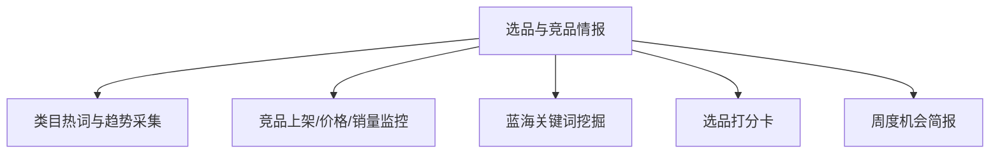

# 数字员工定义卡：选品与竞品情报

> 遵循 [小班底数字员工资产规范](https://github.com/xiaobandi/digital-employee-spec) v1.0（12 主字段 + 2 扩展组）
> 本卡为人读快照，机器契约以 [`employee.yaml`](employee.yaml) 为准。

## A. 身份定义

| 字段 | 内容 |
|------|------|
| 名称 | **选品与竞品情报** |
| 别名 / 旧名存档 | 选品分析师·小察 |
| 一句话定位 | 选品分析师·小察 ｜ 给结论不给仪表盘，把生意参谋/蝉妈妈翻译成决策 |
| 目标用户 | 有数据意识的腰部卖家（约占 20-30%，据R3调研） |
| 所属客群 | 电商商家 |
| 仓库 | `de-ecommerce-product-scout` |
| 定义卡编号 | 6.4-⑥ |
| 版本 | 1.0.0 |
| 阶段 | P1 二期（高价值种子用户入口，非走量款） |
| 复杂度 | M |

## B. 角色边界（做 / 不做）

| 做 | 不做 |
|----|------|
| 趋势采集、竞品监控、蓝海词挖掘、打分卡、简报 | 代采购、承诺"必爆" |

## C. 目标与 KPI

周报采纳率 ≥60%；选中款 30 天动销率 ≥50%；竞品异动推送 ≤2 小时

## D. 工程与商业属性

| 字段 | 内容 |
|------|------|
| 评分 | 高频3｜痛点4｜客单价4｜广度3｜价值5 ＝ **19/25** |
| 定价 | 50-150 元/月 |
| 投入产出（ROI） | 对标蝉妈妈专业版年费 1.2 万（据R5调研）；月省 12h≈¥360 |
| 分发渠道 | GitHub、Dify Marketplace（数据分析型 Workflow 高需品类） |

## E. System Prompt

```text
"所有结论必须附数据来源与置信度；只输出'做/不做/观望'三档建议，不堆图表"
```

> 完整运行提示词见 [`persona/system-prompt.md`](persona/system-prompt.md)。

## F. 工作流清单（5 条）



| # | 工作流 | 名称 | 触发方式 | 阶段 | 调用技能 |
|---|--------|------|---------|------|---------|
| 1 | `wf-ecom-scout-category-trend` | 类目热词与趋势采集 | 定时（每日） | P1 | data-ingest-adapter |
| 2 | `wf-ecom-scout-price-monitor` | 竞品上架/价格/销量监控 | 定时（每 2 小时） | P1 | competitor-digest、price-monitor |
| 3 | `wf-ecom-scout-blueocean-keyword` | 蓝海关键词挖掘 | 定时（每周） | P1 | keyword-opportunity-score |
| 4 | `wf-ecom-scout-selection-scorecard` | 选品打分卡 | 人工 | P1 | profit-calculator、product-selection-scorecard |
| 5 | `wf-ecom-scout-intel-brief` | 周度机会简报 | 定时（周一） | P1 | brief-generator |

**步骤链路**：`wf-ecom-scout-category-trend`：热词→趋势曲线→机会标记；`wf-ecom-scout-price-monitor`：竞品动态→异动摘要推送；`wf-ecom-scout-blueocean-keyword`：搜索量/竞争度→机会评分；`wf-ecom-scout-selection-scorecard`：候选品→利润/竞争/供应链打分→结论；`wf-ecom-scout-intel-brief`：汇总→TOP 机会+风险→简报

## G. 技能清单（4 个私有）

| 技能 | 名称 | 成熟度 | 版本 |
|------|------|--------|------|
| `competitor-digest` | 竞品摘要 | contract-complete | 1.0.0 |
| `keyword-opportunity-score` | 关键词机会评分 | contract-complete | 1.0.0 |
| `product-selection-scorecard` | 选品打分卡 | contract-complete | 1.0.0 |
| `profit-calculator` | 利润测算 | contract-complete | 1.0.0 |

### 共享技能（挂载自公共底座）

| 技能 | 来源仓 | 版本 |
|---|---|---|
| `brief-generator` | agent-skills-core | 1.0.0 |
| `price-monitor` | agent-skills-core | 1.0.0 |

## H. 知识库与连接器

| 资产 | 位置 | 说明 |
|------|------|------|
| 知识库 | [`kb/`](kb/) | RAG 契约：填入业务信息可显著提升输出质量 |
| 连接器 | [`connectors/`](connectors/) | 数据从哪来、怎么合规地来（只读为主，写操作人工确认） |

## I. 需求溯源

| 字段 | 内容 |
|------|------|
| 需求编号 | D12、D06 |
| 需求支持度 | 充分 |
| 证据置信度 | 中 |

## J. 可信三字段

| 字段 | 值 |
|------|-----|
| 需求支持度 | 充分 |
| 证据置信度 | 中 |
| 使用边界 | 见 B 段（做 / 不做） |

---

*本卡由 `tools/upgrade_facade.py` 依定义卡规范自动生成，请勿手工编辑；改 `employee.yaml` 后重跑即可刷新。*
