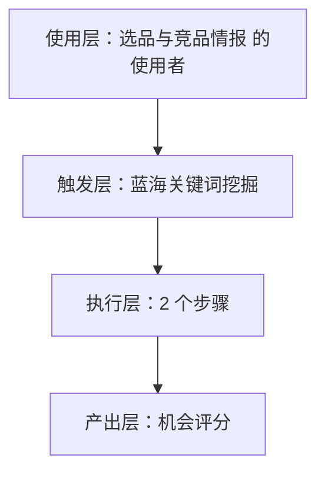
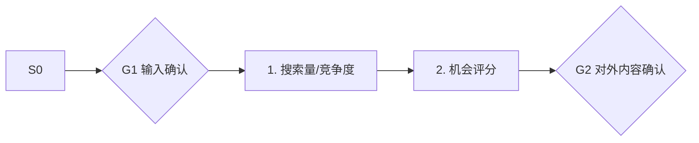

# 蓝海关键词挖掘 · 架构与流程图

## 本工作流的四层结构

| 层 | 内容 |
|---|---|
| 使用层 | 有数据意识的腰部卖家（约占 20-30%，据R3调研）；员工定位：选品分析师·小察 ｜ 给结论不给仪表盘，把生意参谋/蝉妈妈翻译成决策 |
| 触发层 | 关键词 / 显式点名「蓝海关键词挖掘」；触发方式：定时（每周） |
| 执行层 | 搜索量/竞争度 → 机会评分 |
| 产出层 | 机会评分 |

## 执行流程

## 步骤职责表

| # | 步骤 | 承担者 | 为什么 |
|---|---|---|---|
| 1 | 搜索量/竞争度 | 模型 | 需要读懂语境，不可用固定规则替代 |
| 2 | 机会评分 | 模型 | 需要读懂语境，不可用固定规则替代 |

⚠️ 尚未补齐：图中的步骤来自注册表口径，未逐条实跑校验；实跑后请同步修订本页（`发布标准.md` 第六项：通读一遍，不得出现重复填充句）。
